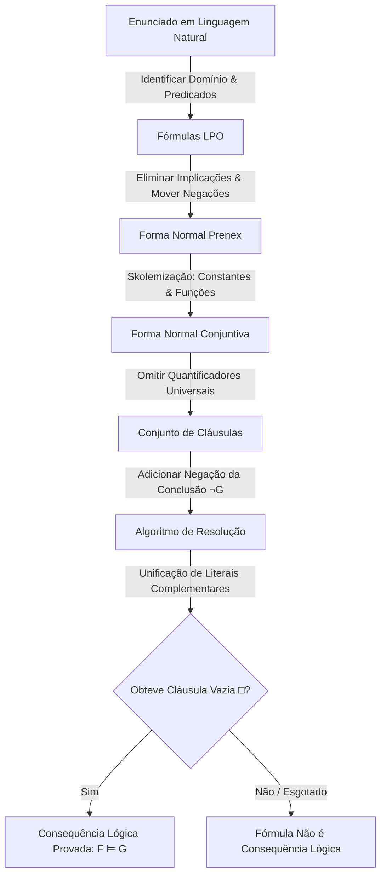

# Guia Definitivo de Estudo: Matemática Discreta (LECI — UA)
### Compilação Integral de Testes, Exames e Exercícios dos Chats do Projeto
**UC:** Matemática Discreta (47166) | **Cursos:** LECI / DETI — Universidade de Aveiro  
**Anos Analisados:** 2023/2024, 2024/2025, 2025/2026 e MiniTestes

---

## 🧭 Como Usar Este Guia para Tirar Nota Máxima
Este guia reúne e melhora todos os exercícios, demonstrações, dúvidas e resoluções trabalhados ao longo de todos os chats deste projeto. Em vez de uma listagem dispersa, cada tópico está estruturado em:
1. **O Método Infalível (Passo a Passo):** A receita exata para resolver o tipo de exercício como os docentes da UA exigem.
2. **Exercícios e Problemas Reais Resolvidos:** Enunciados literais de testes e exames, resolvidos com todas as justificações matemáticas.
3. **Erros Frequentes e "Pegadinhas":** Onde os alunos habitualmente perdem cotação.
4. **Resumo das Fórmulas:** Cheat-sheet rápida para memorização.

---

# MÓDULO 1: Lógica Proposicional e de Primeira Ordem (LPO)
*Cotação típica no exame: 3.5 a 5.5 valores (Geralmente Questão 1 e Questão 2)*

---

### 1.1. Tradução de Linguagem Natural para LPO

#### O Método
1. **Identificar o Universo de Discurso ($U$):**
   * Se o domínio já é restrito (ex.: "Universo dos humanos"), não é estritamente necessário usar o predicado $\text{Humano}(x)$.
   * Se o domínio for geral ("todos os seres"), usa-se implicação $(\to)$ para quantificadores universais e conjunção $(\land)$ para existenciais:
     * *Todo o $A$ é $B$*: $\forall x (A(x) \to B(x))$
     * *Existe um $A$ que é $B$*: $\exists x (A(x) \land B(x))$
     * ⚠️ **Atenção:** Nunca use $\forall x (A(x) \land B(x))$ para "Todo o A é B", nem $\exists x (A(x) \to B(x))$ para "Existe um A que é B".
2. **Identificar se "quem", "alguém", "todos", "só se":**
   * "$A$ só se $B$": $A \to B$.
   * "Quem faz $P$, é $Q$": $\forall x (P(x) \to Q(x))$.

#### Exercícios Resolvidos

##### Exercício 1.1.1 (Exame Recurso 2025/2026 — Q1)
> **Enunciado:** Assuma os seguintes factos no universo (domínio) dos Humanos:  
> (a) Toda a pessoa gosta de alguém.  
> (b) Há uma pessoa que gosta de todas as pessoas.  
> Traduza usando: $\text{Pessoa}(x)$ e $\text{Gosta}(x, y)$.

*   **Resolução (Abordagem de Domínio Restrito a Humanos):**
    *   (a) $\forall x \, \exists y \, \text{Gosta}(x, y)$
    *   (b) $\exists x \, \forall y \, \text{Gosta}(x, y)$
*   **Resolução (Abordagem Formal com Predicado Pessoa):**
    *   (a) $\forall x (\text{Pessoa}(x) \to \exists y (\text{Pessoa}(y) \land \text{Gosta}(x, y)))$
    *   (b) $\exists x (\text{Pessoa}(x) \land \forall y (\text{Pessoa}(y) \to \text{Gosta}(x, y)))$

##### Exercício 1.1.2 (Exame Recurso 2023/2024 — Q1)
> **Enunciado:** Universo dos Humanos. Predicados: $\text{Xibu}(x)$, $\text{Tonga}(y)$, $\text{vendearmas}(x,y)$, $\text{traidor}(x)$, constante $\text{guru}$.  
> (a) "É traidor quem da tribo Xibu venda armas a alguém da tribo Tonga."  
> (b) "Guru da tribo Xibu não vende armas a membros da tribo Tonga."

*   **Resolução:**
    *   (a) $\forall x (\text{Xibu}(x) \land \exists y (\text{Tonga}(y) \land \text{vendearmas}(x, y)) \to \text{traidor}(x))$  
        *Forma equivalente prenex:* $\forall x \forall y (\text{Xibu}(x) \land \text{Tonga}(y) \land \text{vendearmas}(x, y) \to \text{traidor}(x))$
    *   (b) $\text{Xibu}(\text{guru}) \land \forall y (\text{Tonga}(y) \to \neg\text{vendearmas}(\text{guru}, y))$

##### Exercício 1.1.3 (MiniTeste 1 — ex5.jpeg)
> **Enunciado:** Domínio dos animais. $\text{leão}(x)$, $\text{veado}(x)$, $\text{ruge}(x)$, $\text{maisvelho}(x)$, $\text{caça}(y, z)$ ("y caça z").  
> Associe as frases às fórmulas LPO:
> 1. "Os leões caçam veados."
> 2. "Pelo menos um veado é caçado por algum leão."
> 3. "Existe um leão que caça todos os veados."
> 4. "Todos os leões, exceto os mais velhos, rugem."

*   **Resolução:**
    *   "Os leões caçam veados" (Todo o leão caça pelo menos um veado): $\forall x \exists z (\text{leão}(x) \to (\text{veado}(z) \land \text{caça}(x, z)))$
    *   "Pelo menos um veado é caçado por algum leão": $\exists x \exists z (\text{veado}(x) \land \text{leão}(z) \land \text{caça}(z, x))$
    *   "Existe um leão que caça todos os veados": $\exists x \forall z (\text{leão}(x) \land (\text{veado}(z) \to \text{caça}(x, z)))$
    *   "Todos os leões, exceto os mais velhos, rugem": $\forall x ((\text{leão}(x) \land \neg\text{maisvelho}(x)) \to \text{ruge}(x))$

---

### 1.2. Skolemização e Passagem para a Forma Clausal

#### As 5 Regras de Ouro
1. **Eliminar Implicações:** $A \to B \equiv \neg A \lor B$.
2. **Interiorizar Negações (De Morgan e Quantificadores):**
   * $\neg \forall x \, \phi \equiv \exists x \, \neg \phi$
   * $\neg \exists x \, \phi \equiv \forall x \, \neg \phi$
   * $\neg (A \land B) \equiv \neg A \lor \neg B$
   * $\neg (A \lor B) \equiv \neg A \land \neg B$
3. **Renomear Variáveis:** Garantir que cada quantificador usa uma variável com nome único.
4. **Skolemização:**
   * Se $\exists y$ **NÃO** está dentro do escopo de nenhum $\forall$, substitui-se $y$ por uma **constante de Skolem** ($a, b, c$).
   * Se $\exists y$ está dentro do escopo de $\forall x_1, \dots, \forall x_k$, substitui-se $y$ por uma **função de Skolem** $f(x_1, \dots, x_k)$.
5. **Forma Normal Conjuntiva (FNC) e Omissão de $\forall$:**
   * Distribuir $\lor$ sobre $\land$: $A \lor (B \land C) \equiv (A \lor B) \land (A \lor C)$.
   * Cada conjunção dá origem a uma **cláusula** separada (disjunção de literais).

#### Exercício Resolvido (Exame Recurso 2024/2025 — Q1a)
> **Enunciado:** Partindo de $\{F_1, F_2, F_3, \neg F_4\}$ mostre que se obtém o conjunto de cláusulas:  
> $\{\neg P(x, y) \lor \neg Q(z, y) \lor P(x, z),\, \neg R(x) \lor Q(f(x), x),\, \neg R(x) \lor S(f(x)),\, P(a, b),\, R(b),\, \neg P(a, x) \lor \neg S(x)\}$  
> Onde:  
> $F_1 \equiv \forall x \forall y \forall z (P(x, y) \land Q(z, y) \to P(x, z))$  
> $F_2 \equiv \forall x (R(x) \to \exists y (Q(y, x) \land S(y)))$  
> $F_3 \equiv \exists x (P(a, x) \land R(x))$  
> $F_4 \equiv \exists x (P(a, x) \land S(x))$

*   **Passo a passo da Skolemização:**
    1.  **$F_1$:**
        $$\forall x \forall y \forall z (\neg(P(x, y) \land Q(z, y)) \lor P(x, z)) \equiv \forall x \forall y \forall z (\neg P(x, y) \lor \neg Q(z, y) \lor P(x, z))$$
        $\implies C_1: \neg P(x, y) \lor \neg Q(z, y) \lor P(x, z)$.
    2.  **$F_2$:**
        $$\forall x (\neg R(x) \lor \exists y (Q(y, x) \land S(y))) \equiv \forall x \exists y (\neg R(x) \lor (Q(y, x) \land S(y)))$$
        Como $\exists y$ está sob $\forall x$, skolemizamos $y = f(x)$:
        $$\forall x [(\neg R(x) \lor Q(f(x), x)) \land (\neg R(x) \lor S(f(x)))]$$
        $\implies C_2: \neg R(x) \lor Q(f(x), x)$  
        $\implies C_3: \neg R(x) \lor S(f(x))$
    3.  **$F_3$:**
        $\exists x (P(a, x) \land R(x))$. Como $\exists x$ não tem $\forall$ antes, skolemizamos com a constante $b$:
        $$P(a, b) \land R(b)$$
        $\implies C_4: P(a, b)$  
        $\implies C_5: R(b)$
    4.  **$\neg F_4$:**
        $$\neg \exists x (P(a, x) \land S(x)) \equiv \forall x \neg(P(a, x) \land S(x)) \equiv \forall x (\neg P(a, x) \lor \neg S(x))$$
        $\implies C_6: \neg P(a, x) \lor \neg S(x)$. $\blacksquare$

---

### 1.3. Algoritmo de Unificação Termo a Termo

#### O Método
Para unificar $P(t_1, \dots, t_n)$ com $P(s_1, \dots, s_n)$:
1. Percorrer os argumentos da esquerda para a direita.
2. Ao encontrar uma discrepância entre variável $x$ e termo $t$:
   * **Occurs Check:** Verificar se $x$ ocorre dentro de $t$. Se ocorrer (ex: $x$ e $f(x)$), **falha a unificação**.
   * Se não ocorrer, a substituição $\{t/x\}$ é adicionada ao unificador.
   * Aplicar essa substituição a todos os restantes termos antes de prosseguir!

#### Exercícios Resolvidos

##### Exercício 1.3.1 (MiniTeste 1 — ex1.jpeg)
> **Enunciado:** Determine o unificador mais geral (mgu) de $W = \{P(x, a, z), P(f(z), y, y)\}$.

*   **Resolução:**
    1.  1º argumento: variável $x$ e termo $f(z) \implies \theta_1 = \{f(z)/x\}$.  
        Aplicando: $W\theta_1 = \{P(f(z), a, z), P(f(z), y, y)\}$.
    2.  2º argumento: constante $a$ e variável $y \implies \theta_2 = \{a/y\}$.  
        Aplicando: $W\theta_1\theta_2 = \{P(f(z), a, z), P(f(z), a, a)\}$.
    3.  3º argumento: variável $z$ e constante $a \implies \theta_3 = \{a/z\}$.  
        Atualizando o termo anterior onde $z$ aparecia ($x = f(z) = f(a)$).
    *   **MGU Final:** $\sigma = \{f(a)/x,\, a/y,\, a/z\}$.

##### Exercício 1.3.2 (Exame Modelo Recurso 2 — Grupo 1a)
> **Enunciado:** Unificar $\mathcal{E} = \{ P(x, f(y), y),\, P(g(z), f(a), a) \}$.

*   **Resolução:**
    1. 1º argumento: $x$ e $g(z) \implies \theta_1 = \{g(z)/x\}$.
    2. 2º argumento: $f(y)$ e $f(a) \implies y$ e $a \implies \theta_2 = \{a/y\}$.
    3. 3º argumento: após aplicar $\theta_2$, o 3º argumento de ambos passa a ser $a$ e $a$ (idênticos).
    *   **MGU Final:** $\sigma = \{g(z)/x,\, a/y\}$. Termo unificado: $P(g(z), f(a), a)$.

---

### 1.4. Método de Resolução em Primeira Ordem

#### Regras Obrigatórias para Não Perder Pontos
> [!IMPORTANT]
> 1. **Padronização de Variáveis (Standardizing Apart):** Em cada passo de resolução, renomeie os índices das variáveis das cláusulas (ex: $x_1, y_1$ e $x_2, y_2$). Cláusulas diferentes NUNCA podem partilhar o mesmo nome de variável livre na folha de exame.
> 2. **Identificar o MGU:** Em cada passo, indique explicitamente o unificador utilizado: $\theta = \{ \dots \}$.
> 3. **Provas Negativas (Exame Final 25/26):** Se uma fórmula $G$ NÃO for consequência lógica, a árvore de resolução não fecha (é impossível deduzir $\square$). Indique explicitamente: *"Aplicando o método de resolução não é possível derivar a cláusula vazia $\square$, logo $F \not\models G$"*.

#### Exercício Resolvido Completo (Exame Recurso 2025/2026 — Q2)
> **Enunciado:** Mostrar por resolução que $\{F_1, F_2\} \models F_3$, onde:  
> $F_1 \equiv \forall x \forall y ((P(y) \land Q(x, y)) \to R(x))$  
> $F_2 \equiv \forall x (S(x) \to \exists y (P(y) \land Q(x, y)))$  
> $F_3 \equiv \forall x (S(x) \to R(x))$

*   **Cláusulas obtidas de $\{F_1, F_2, \neg F_3\}$:**
    *   $C_1: \neg P(y_1) \lor \neg Q(x_1, y_1) \lor R(x_1)$
    *   $C_2: \neg S(x_2) \lor P(f(x_2))$
    *   $C_3: \neg S(x_3) \lor Q(x_3, f(x_3))$
    *   $C_4: S(a)$ (da negação de $F_3$, com constante de Skolem $a$)
    *   $C_5: \neg R(a)$ (da negação de $F_3$)
*   **Derivação por Resolução:**
    1.  Resolver $C_2$ com $C_4$ com $\theta_1 = \{a/x_2\}$:  
        $$\implies C_6: P(f(a))$$
    2.  Resolver $C_3$ com $C_4$ com $\theta_2 = \{a/x_3\}$:  
        $$\implies C_7: Q(a, f(a))$$
    3.  Resolver $C_1$ com $C_6$ no literal $P$, com $\theta_3 = \{f(a)/y_1\}$:  
        $$\implies C_8: \neg Q(x_1, f(a)) \lor R(x_1)$$
    4.  Resolver $C_8$ com $C_7$ no literal $Q$, com $\theta_4 = \{a/x_1\}$:  
        $$\implies C_9: R(a)$$
    5.  Resolver $C_9$ com $C_5$:  
        $$\implies C_{10}: \square \quad (\text{Cláusula Vazia})$$
*   **Conclusão:** Como derivámos a cláusula vazia $\square$, o conjunto de cláusulas é insatisfatível, provando que $\{F_1, F_2\} \models F_3$. $\blacksquare$

---

### 1.5. Semântica, Modelos e Valorações $((M, V) \models \phi)$

#### O Método
Para avaliar se uma interpretação $(M, V)$ é modelo de uma fórmula quantificada:
*   $\forall x \, \psi(x)$: Tem de ser verdadeira para **todos** os elementos do domínio $D$. Basta falhar para 1 elemento para a fórmula ser falsa.
*   $\exists y \, \psi(x, y)$: Para o $x$ fixado, basta encontrar **pelo menos um** $y \in D$ que torne a expressão verdadeira.
*   Em domínios finitos pequenos (ex.: $\{1, 3, 5, 15\}$), faz-se a verificação exaustiva elemento a elemento.

#### Exercícios Resolvidos

##### Exercício 1.5.1 (Exame Final 2025/2026 — Q2)
> **Enunciado:** Domínio $D = \{1, 3, 5, 15\}$. Predicados: $L(x, y): x < y$; $M(y, x): \text{"}y \text{ é múltiplo de } x\text{"}$.  
> Avalie se $(M, V) \models \phi$, onde $\phi \equiv \forall x \exists y (M(y, x) \to L(x, y))$.

*   **Resolução:**
    Para ser modelo, para todo o $x \in D$ deve existir pelo menos um $y \in D$ tal que a implicação seja verdadeira.
    Lembre-se: uma implicação $p \to q$ só é falsa quando $p$ é V e $q$ é F.
    *   Testemos $x = 15$:
        *   Para $y = 1$: $M(1, 15)$ ("1 é múltiplo de 15") é Falso. Logo $F \to \dots$ é **Verdadeiro**.
        *   Basta isso! Como para $y=1$ a implicação é verdadeira, existe $y$ para $x=15$.
    *   Testemos $x = 1$:
        *   Para $y = 3$: $M(3, 1)$ é V ("3 é múltiplo de 1") e $L(1, 3)$ é V ("1 < 3"). Logo $V \to V$ é **Verdadeiro**.
    *   Testemos $x = 3$:
        *   Para $y = 1$: $M(1, 3)$ é Falso $\implies F \to \dots$ é **Verdadeiro**.
    *   Testemos $x = 5$:
        *   Para $y = 1$: $M(1, 5)$ é Falso $\implies F \to \dots$ é **Verdadeiro**.
    *   **Conclusão:** Para todo o $x \in D$ existe $y \in D$ que satisfaz a fórmula. Logo, a interpretação $(M, V)$ **é um modelo** para $\phi$.

##### Exercício 1.5.2 (MiniTeste 1 — ex3.jpeg)
> **Enunciado:** Domínio $D = \mathbb{N} = \{1, 2, 3, \dots\}$, $a = 2$, $f(x) = x+1$, $Q(x)$: "$x$ é par", $R(x, y)$: "$y$ é múltiplo de $x$". Valoração $V(x)=3, V(y)=6$.
> 1. $\forall x \, Q(f(x))$: **Não válida** (se $x=2$, $f(2)=3$ que é ímpar).
> 2. $\exists x \forall y (\neg Q(x) \to R(x, y))$: **Válida** (escolhendo $x$ par, o antecedente $\neg Q(x)$ é falso, tornando a implicação trivialmente verdadeira para todo o $y$).
> 3. $\forall y \exists x (R(x, y) \to Q(x))$: **Válida** (escolhendo $x=2y$, $y$ não é múltiplo de $2y$, logo antecedente é falso; ou escolhendo $x=2$ se $y$ for par).
> 4. $\exists y (R(f(a), y) \land \neg Q(x))$: $f(a)=3$, $\neg Q(3)$ é V; escolhendo $y=6$ (múltiplo de 3), é **Válida**.
> 5. $\neg R(f(x), f(y))$: $f(3)=4, f(6)=7$. 7 não é múltiplo de 4. Logo $\neg R(4, 7)$ é verdadeiro $\implies$ **Válida**.
> 6. $\neg R(a, f(x)) \lor Q(f(a))$: $a=2, f(3)=4$. $R(2, 4)$ é V, logo $\neg R$ é F. Mas $f(a)=3$ e $Q(3)$ é F. Disjunção de $F \lor F$ é Falsa $\implies$ **Não válida**.

---

# MÓDULO 2: Combinatória, Contagem e Identidades
*Cotação típica no exame: 3.5 a 5.5 valores*

---

### 2.1. Princípio da Casa dos Pombos (PCP / Gaiola de Pombos)

#### O Método
* Identificar claramente os **Pombos** ($N$ objetos a distribuir) e as **Casas** ($k$ categorias ou valores possíveis).
* **Versão Básica:** Se $N > k$, pelo menos uma casa contém $\ge 2$ pombos.
* **Versão Generalizada:** Pelo menos uma casa contém pelo menos $\left\lceil \frac{N}{k} \right\rceil$ pombos.
* **Problemas de Pior Cenário:** Para garantir que pelo menos $M$ pombos fiquem na mesma casa, o número mínimo de pombos necessários é:
  $$N_{\min} = k(M - 1) + 1$$

#### Exercícios Resolvidos

##### Exercício 2.1.1 (Exame Final 2024/2025 — Q2)
> **Enunciado:** Numa escola, 12 alunos vão receber um conjunto de 3 canetas, de cores diferentes, escolhidas entre 5 cores disponíveis.  
> (a) Mostre que existem pelo menos dois alunos que receberam exatamente o mesmo conjunto de canetas.  
> (b) Quantos alunos seriam necessários para garantir que pelo menos três recebem exatamente o mesmo conjunto? Justifique.

*   **Resolução:**
    *   **Cálculo das Casas:** As casas são os conjuntos possíveis de 3 canetas de cores distintas escolhidas de 5. Como a ordem no estojo não interessa:
        $$k = \binom{5}{3} = \frac{5 \times 4}{2 \times 1} = 10 \text{ conjuntos possíveis}$$
    *   **(a)** Temos $N = 12$ alunos (pombos) e $k = 10$ conjuntos (casas). Como $12 > 10$, pelo Princípio da Casa dos Pombos, pelo menos dois alunos receberão exatamente o mesmo conjunto ($\lceil 12/10 \rceil = 2$).
    *   **(b)** Pelo pior cenário, cada um dos 10 conjuntos é atribuído a 2 alunos sem que haja repetição tripla: $10 \times 2 = 20$ alunos. Adicionando mais 1 aluno, garantimos a repetição tripla:
        $$N_{\min} = 10(3 - 1) + 1 = 21 \text{ alunos.}$$

##### Exercício 2.1.2 (Exame Recurso 2023/2024 — Q3)
> **Enunciado:** Seja $A = \{1, 2, \dots, 29\}$. Mostre que qualquer subconjunto $S \subset A$ com $|S| = 16$ tem pelo menos dois elementos cuja soma é 30.

*   **Resolução:**
    *   Agrupamos os elementos de $A$ em pares (casas) que somam 30, mais os elementos isolados:
        *   Pares que somam 30: $\{1, 29\}, \{2, 28\}, \{3, 27\}, \dots, \{14, 16\}$ (são 14 pares).
        *   Elemento que não forma par: $\{15\}$ (pois $15+15=30$, mas não há repetição em conjuntos).
    *   Temos no total $14 + 1 = 15$ casas.
    *   Como escolhemos $|S| = 16$ números (pombos) e temos apenas 15 casas, pelo Princípio da Gaiola de Pombos pelo menos dois números de $S$ pertencem à mesma casa.
    *   Como o conjunto $\{15\}$ só tem 1 elemento, a casa repetida tem de ser um dos 14 pares $\{x, 30-x\}$, provando que existem dois elementos cuja soma é 30. $\blacksquare$

---

### 2.2. Princípio da Inclusão-Exclusão (PIE)

#### O Método
Para 3 conjuntos:
$$|A \cup B \cup C| = (|A| + |B| + |C|) - (|A \cap B| + |A \cap C| + |B \cap C|) + |A \cap B \cap C|$$
Elemento que não pertence a nenhum:
$$|U \setminus (A \cup B \cup C)| = |U| - |A \cup B \cup C|$$

#### Exercícios Resolvidos

##### Exercício 2.2.1 (Exame Recurso 2024/2025 — Q2)
> **Enunciado:** 70 ouvintes de rádio. 47 gostam de Fado ($F$), 35 de Jazz ($J$), 20 de K-Pop ($K$). 23 gostam de F e J, 12 de K e J, 11 de K e F, e 5 gostam dos três géneros. Quantos ouvintes não gostam de nenhum dos três?

*   **Resolução:**
    $$|F \cup J \cup K| = (47 + 35 + 20) - (23 + 12 + 11) + 5 = 102 - 46 + 5 = 61$$
    Ouvintes que não gostam de nenhum:
    $$|U| - |F \cup J \cup K| = 70 - 61 = 9 \text{ ouvintes.}$$

##### Exercício 2.2.2 (Exame Final 2025/2026 — Q3b)
> **Enunciado:** Senhas de 8 letras escolhidas no alfabeto $\{x, y, z\}$. Quantas senhas incluem todas as três letras?

*   **Resolução:**
    *   Universo total de senhas: $|U| = 3^8 = 6561$.
    *   Sejam $A_x, A_y, A_z$ os conjuntos de senhas que **não contêm** a letra $x$, $y$ e $z$, respetivamente:
        *   Excluir 1 letra (usar apenas 2 letras): $|A_x| = |A_y| = |A_z| = 2^8 = 256$.
        *   Excluir 2 letras (usar apenas 1 letra): $|A_x \cap A_y| = |A_x \cap A_z| = |A_y \cap A_z| = 1^8 = 1$.
        *   Excluir as 3 letras: $|A_x \cap A_y \cap A_z| = 0$.
    *   Pelo PIE, o número de senhas que omitem pelo menos uma letra é:
        $$|A_x \cup A_y \cup A_z| = 3 \times 2^8 - 3 \times 1^8 + 0 = 3(256) - 3 = 768 - 3 = 765$$
    *   Senhas que incluem todas as três letras:
        $$N = |U| - |A_x \cup A_y \cup A_z| = 6561 - 765 = 5796 \text{ senhas.}$$

---

### 2.3. Combinações com Repetição e "Estrelas e Barras"

#### A Fórmula
Distribuir $k$ objetos indistinguíveis por $n$ categorias distinguíveis, ou número de soluções inteiras de:
$$x_1 + x_2 + \dots + x_n = k, \quad x_i \ge 0$$
é dado por:
$$CR_n^k = \binom{n + k - 1}{k} = \binom{n + k - 1}{n - 1}$$

#### A Bijeção Formal Exigida nos Exames
> [!IMPORTANT]
> Quando o exame pede *"Defina uma função bijetiva entre sequências binárias e soluções inteiras"*, você DEVE escrever os 4 passos formais:
> 1. Definir os conjuntos $S$ (sequências) e $T$ (soluções).
> 2. Definir a função $f(s) = (x_1, \dots, x_n)$ usando as posições dos zeros $p_1 < p_2 < \dots < p_{n-1}$ como separadores: $x_1 = p_1 - 1$, $x_i = p_i - p_{i-1} - 1$, $x_n = L - p_{n-1}$.
> 3. Provar que a soma é constante ($\sum x_i = k$) e que $x_i \ge 0$.
> 4. Demonstrar a **Injetividade** (posições dos zeros são únicas) e a **Sobrejetividade** (dada uma solução, constrói-se a sequência de forma unívoca).

#### Exercícios Resolvidos

##### Exercício 2.3.1 (Exame Recurso 2024/2025 — Q3)
> **Enunciado:** Defina uma função bijetiva entre o conjunto das sequências binárias de 8 uns e 3 zeros e as soluções inteiras não-negativas de $x_1 + x_2 + x_3 + x_4 = 8$. Obtenha o número de soluções em termos de combinações com repetição.

*   **Resolução:**
    *   Comprimento total da sequência: $8 \text{ uns} + 3 \text{ zeros} = 11$ bits.
    *   Os 3 zeros definem 4 intervalos: antes do 1º zero ($x_1$), entre o 1º e 2º ($x_2$), entre o 2º e 3º ($x_3$) e após o 3º ($x_4$).
    *   Como o total de uns é 8, $x_1 + x_2 + x_3 + x_4 = 8$ com $x_i \ge 0$.
    *   A função que mapeia as posições dos zeros $(p_1, p_2, p_3)$ para $(x_1, x_2, x_3, x_4)$ é bijetiva.
    *   **Número de soluções:**
        $$CR_4^8 = \binom{4 + 8 - 1}{8} = \binom{11}{8} = \binom{11}{3} = \frac{11 \times 10 \times 9}{3 \times 2 \times 1} = 165 \text{ soluções.}$$

##### Exercício 2.3.2 (Exame Recurso 2025/2026 — Q3b)
> **Enunciado:** Distribuir 22 turistas por 4 locais, com pelo menos 4 turistas por local. Representado por um 4-uplo $(x_1, x_2, x_3, x_4)$.

*   **Resolução:**
    $$x_1 + x_2 + x_3 + x_4 = 22, \quad \text{com } x_i \ge 4$$
    Mudança de variável: seja $y_i = x_i - 4 \ge 0$.
    $$(y_1 + 4) + (y_2 + 4) + (y_3 + 4) + (y_4 + 4) = 22 \implies y_1 + y_2 + y_3 + y_4 = 6$$
    Número de soluções:
    $$CR_4^6 = \binom{4 + 6 - 1}{6} = \binom{9}{6} = \binom{9}{3} = \frac{9 \times 8 \times 7}{6} = 84 \text{ possibilidades.}$$

---

### 2.4. Teorema Multinomial e Contagem com Paridade

#### Fórmula do Teorema Multinomial
$$(a_1 + a_2 + \dots + a_m)^n = \sum_{k_1 + \dots + k_m = n} \frac{n!}{k_1! k_2! \dots k_m!} a_1^{k_1} a_2^{k_2} \dots a_m^{k_m}$$

#### Exercícios Resolvidos

##### Exercício 2.4.1 (Exame Recurso 2024/2025 — Q4)
> **Enunciado:** No desenvolvimento de $(x^2 - xz + y^3)^8$ determine o coeficiente do termo em $x^7 z^3 y^9$.

*   **Resolução:**
    O termo geral é:
    $$\frac{8!}{k_1! k_2! k_3!} (x^2)^{k_1} (-xz)^{k_2} (y^3)^{k_3} = (-1)^{k_2} \frac{8!}{k_1! k_2! k_3!} x^{2k_1 + k_2} z^{k_2} y^{3k_3}$$
    Igualando os expoentes a $x^7 z^3 y^9$:
    1.  Para $y$: $3k_3 = 9 \implies k_3 = 3$.
    2.  Para $z$: $k_2 = 3$.
    3.  Para $x$: $2k_1 + k_2 = 7 \implies 2k_1 + 3 = 7 \implies k_1 = 2$.
    *Verificação da soma:* $k_1 + k_2 + k_3 = 2 + 3 + 3 = 8$ (Válido!).
    *Cálculo do Coeficiente:*
    $$C = (-1)^3 \frac{8!}{2! 3! 3!} = -1 \times \frac{40320}{2 \times 6 \times 6} = -1 \times 560 = -560.$$

##### Exercício 2.4.2 (Exame Final 2025/2026 — Q3c)
> **Enunciado:** Senhas de comprimento 8 no alfabeto $\{x, y, z\}$ com um número **ímpar** de letras $x$, **uma só** letra $y$ e sem restrições em $z$.

*   **Resolução:**
    1. Escolher a posição para a única letra $y$: $\binom{8}{1} = 8$ opções.
    2. Sobram 7 posições para preencher com $x$ e $z$. O número de $x$ tem de ser ímpar: $k \in \{1, 3, 5, 7\}$.
    3. Para cada $k$, escolhemos as posições de $x$ em $\binom{7}{k}$ maneiras, e o resto é preenchido com $z$.
    *Pela identidade da soma de coeficientes ímpares:*
    $$\binom{7}{1} + \binom{7}{3} + \binom{7}{5} + \binom{7}{7} = 2^{7-1} = 2^6 = 64$$
    Total de senhas: $8 \times 64 = 512$.

---

### 2.5. Demonstrações e Identidades Combinatórias (Dupla Contagem)

#### Exercício 2.5.1 (Exame Recurso 2025/2026 — Q7)
> **Enunciado:** Usando um argumento combinatório adequado prove que:
> $$\sum_{k=0}^n \binom{n}{k}^2 = \binom{2n}{n}, \quad n \ge 0$$

*   **Demonstração Formal por Dupla Contagem:**
    *   **História Combinatória:** Imagine um grupo de $2n$ pessoas constituído por $n$ homens e $n$ mulheres. Pretendemos formar uma comissão de exatamente $n$ pessoas.
    *   **Lado Direito (RHS):** O número de formas de escolher $n$ pessoas de entre as $2n$ pessoas sem qualquer restrição é diretamente $\binom{2n}{n}$.
    *   **Lado Esquerdo (LHS):** Particionamos a escolha com base no número $k$ de homens selecionados ($0 \le k \le n$):
        *   Se escolhermos $k$ homens (há $\binom{n}{k}$ formas), as restantes $n-k$ vagas têm de ser preenchidas por mulheres (há $\binom{n}{n-k}$ formas).
        *   Pela simetria dos coeficientes binomiais, $\binom{n}{n-k} = \binom{n}{k}$.
        *   Logo, para um $k$ fixo, há $\binom{n}{k} \times \binom{n}{k} = \binom{n}{k}^2$ maneiras.
        *   Somando sobre todos os valores possíveis de $k$, obtemos $\sum_{k=0}^n \binom{n}{k}^2$.
    *   Como ambos os lados contam o mesmo número de comissões, as expressões são iguais. $\blacksquare$

---

# MÓDULO 3: Relações de Recorrência e Funções Geradoras
*Cotação típica no exame: 3.5 a 5.0 valores*

---

### 3.1. Resolução Algébrica de Recorrências (1ª e 2ª Ordem)

#### O Método dos Coeficientes Indeterminados
$$a_n = c_1 a_{n-1} + c_2 a_{n-2} + f(n)$$
1. **Solução Homogénea ($a_n^{(h)}$):** Resolver a equação característica $r^2 - c_1 r - c_2 = 0$.
   * Raízes reais distintas $r_1 \neq r_2$: $a_n^{(h)} = A r_1^n + B r_2^n$.
   * Raiz dupla $r_1 = r_2 = r$: $a_n^{(h)} = (A + Bn) r^n$.
2. **Solução Particular ($a_n^{(p)}$):** Formulada de acordo com $f(n)$:
   * Se $f(n) = C$ (constante): tentar $a_n^{(p)} = K$ (se 1 não for raiz) ou $K n$ (se 1 for raiz).
   * Se $f(n) = P(n)$ (polinómio): tentar polinómio de mesmo grau multiplicado por $n^s$ onde $s$ é a multiplicidade de 1 na característica.
   * Se $f(n) = \beta^n$: tentar $K \beta^n$. Se $\beta$ coincidir com uma raiz de multiplicidade $s$, usar $K n^s \beta^n$.
3. **Solução Geral:** $a_n = a_n^{(h)} + a_n^{(p)}$.
4. **Condições Iniciais:** Montar e resolver o sistema linear para as constantes $A$ e $B$.

#### Exercícios Resolvidos

##### Exercício 3.1.1 (Exame Final 2024/2025 — Q4)
> **Enunciado:** $a_n = a_{n-1} + 2(n-1), \quad n \ge 2$, com $a_1 = 2$.

*   **Resolução por Somas Telescópicas:**
    $$a_n - a_{n-1} = 2(n-1)$$
    $$\sum_{k=2}^n (a_k - a_{k-1}) = \sum_{k=2}^n 2(k-1) = 2 \sum_{j=1}^{n-1} j$$
    $$a_n - a_1 = 2 \times \frac{(n-1)n}{2} = n^2 - n$$
    $$a_n = n^2 - n + a_1 = n^2 - n + 2, \quad \forall n \ge 1.$$

##### Exercício 3.1.2 (Exame Final 2023/2024 — Q4)
> **Enunciado:** $a_n - 6a_{n-1} + 9a_{n-2} = (-3)^n, \quad n \ge 2$, com $a_0 = 1, a_1 = 3$.

*   **Resolução:**
    1.  *Homogénea:* $r^2 - 6r + 9 = 0 \implies (r-3)^2 = 0 \implies r = 3$ (raiz dupla).
        $$a_n^{(h)} = (C_1 + C_2 n) 3^n$$
    2.  *Particular:* $f(n) = (-3)^n$. Como $-3 \neq 3$, não há conflito! Tentamos $a_n^{(p)} = A (-3)^n$.
        $$A(-3)^n - 6A(-3)^{n-1} + 9A(-3)^{n-2} = (-3)^n$$
        Dividindo por $(-3)^{n-2}$:
        $$A(-3)^2 - 6A(-3) + 9A = (-3)^2 \implies 9A + 18A + 9A = 9 \implies 36A = 9 \implies A = \frac{1}{4}$$
        $$a_n^{(p)} = \frac{1}{4} (-3)^n$$
    3.  *Solução Geral:* $a_n = (C_1 + C_2 n) 3^n + \frac{1}{4} (-3)^n$.
    4.  *Condições Iniciais:*
        *   $n=0: C_1 + \frac{1}{4} = 1 \implies C_1 = \frac{3}{4}$.
        *   $n=1: (C_1 + C_2) 3 - \frac{3}{4} = 3 \implies 3C_1 + 3C_2 = \frac{15}{4} \implies \frac{9}{4} + 3C_2 = \frac{15}{4} \implies 3C_2 = \frac{6}{4} \implies C_2 = \frac{1}{2}$.
    *   **Fórmula Fechada:**
        $$a_n = \left(\frac{3}{4} + \frac{1}{2} n\right) 3^n + \frac{1}{4} (-3)^n = \frac{2n + 3}{4} 3^n + \frac{1}{4} (-3)^n.$$

##### Exercício 3.1.3 (Exame Final 2025/2026 — Q4)
> **Enunciado:** $a_n = 4a_{n-2} - 3, \quad n \ge 2$, com $a_0 = 2, a_1 = 3$.

*   **Resolução:**
    1.  *Homogénea:* $a_n - 4a_{n-2} = 0 \implies r^2 - 4 = 0 \implies r = \pm 2$.
        $$a_n^{(h)} = A \cdot 2^n + B \cdot (-2)^n$$
    2.  *Particular:* Termo constante $-3$. Tentamos constante $K$:
        $$K = 4K - 3 \implies -3K = -3 \implies K = 1 \implies a_n^{(p)} = 1$$
    3.  *Solução Geral:* $a_n = A \cdot 2^n + B \cdot (-2)^n + 1$.
    4.  *Condições Iniciais:*
        *   $n=0: A + B + 1 = 2 \implies A + B = 1$
        *   $n=1: 2A - 2B + 1 = 3 \implies 2A - 2B = 2 \implies A - B = 1$
        *   Somando: $2A = 2 \implies A = 1$, logo $B = 0$.
    *   **Fórmula Fechada:** $a_n = 2^n + 1, \quad \forall n \ge 0$.

---

### 3.2. Funções Geradoras Ordinárias (FGO) e Reversão

#### O Significado Fundamental
$$f(x) = \sum_{n=0}^\infty a_n x^n = a_0 + a_1 x + a_2 x^2 + \dots$$
O índice $n$ da sucessão $a_n$ corresponde rigorosamente ao **expoente de $x^n$** na expansão em série de potências.

#### Exercícios Resolvidos

##### Exercício 3.2.1 (Exame Final 2025/2026 — Q5)
> **Enunciado:** Determine a sucessão $(a_n)_{n \ge 0}$ associada à função geradora
> $$f(x) = \frac{2x}{(2+x)(2-x)} + 1 - x$$

*   **Resolução Oficial Passo a Passo (via Frações Parciais):**
    1.  **Decomposição em frações parciais:**
        $$\frac{2x}{(2+x)(2-x)} = \frac{A}{2+x} + \frac{B}{2-x}$$
        $$2x = A(2-x) + B(2+x)$$
        *   Para $x = 2$: $2(2) = B(2+2) \implies 4 = 4B \implies B = 1$
        *   Para $x = -2$: $2(-2) = A(2 - (-2)) \implies -4 = 4A \implies A = -1$
        
        Logo:
        $$\frac{2x}{(2+x)(2-x)} = -\frac{1}{2+x} + \frac{1}{2-x}$$

    2.  **Desenvolvimento de cada parcela em série de potências** (usando $\frac{1}{1-\alpha x} = \sum_{n=0}^\infty (\alpha x)^n$ do formulário):
        *   **Parcela $\frac{1}{2-x}$:**
            $$\frac{1}{2-x} = \frac{1}{2\left(1 - \frac{x}{2}\right)} = \frac{1}{2} \sum_{n=0}^\infty \left(\frac{x}{2}\right)^n = \sum_{n=0}^\infty \frac{1}{2^{n+1}} x^n = \sum_{n=0}^\infty \left(\frac{1}{2}\right)^{n+1} x^n$$
        *   **Parcela $-\frac{1}{2+x}$:**
            $$-\frac{1}{2+x} = -\frac{1}{2\left(1 - \left(-\frac{x}{2}\right)\right)} = -\frac{1}{2} \sum_{n=0}^\infty \left(-\frac{x}{2}\right)^n = \sum_{n=0}^\infty -\left(\frac{1}{2}\right) \left(-\frac{1}{2}\right)^n x^n = \sum_{n=0}^\infty \left(-\frac{1}{2}\right)^{n+1} x^n$$
            *(Nota: $-1 \cdot (-1)^n = (-1)^{n+1}$, logo $- \frac{1}{2} \cdot (-1)^n \left(\frac{1}{2}\right)^n = (-1)^{n+1} \left(\frac{1}{2}\right)^{n+1} = \left(-\frac{1}{2}\right)^{n+1}$).*

    3.  **Soma das séries da fração:**
        $$\frac{2x}{(2+x)(2-x)} = \sum_{n=0}^\infty \left[ \left(-\frac{1}{2}\right)^{n+1} + \left(\frac{1}{2}\right)^{n+1} \right] x^n$$

    4.  **Adicionar a parte polinomial restante $1 - x$ e identificar $a_n$:**
        $$f(x) = (1 - x) + \sum_{n=0}^\infty \left[ \left(-\frac{1}{2}\right)^{n+1} + \left(\frac{1}{2}\right)^{n+1} \right] x^n$$
        *   **Para $n = 0$ (termo constante):**
            $$a_0 = 1 + \left(-\frac{1}{2}\right)^1 + \left(\frac{1}{2}\right)^1 = 1 - \frac{1}{2} + \frac{1}{2} = 1$$
        *   **Para $n = 1$ (coeficiente de $x^1$):**
            $$a_1 = -1 + \left(-\frac{1}{2}\right)^2 + \left(\frac{1}{2}\right)^2 = -1 + \frac{1}{4} + \frac{1}{4} = -1 + \frac{1}{2} = -\frac{1}{2}$$
        *   **Para $n \ge 2$:** O polinómio $1 - x$ não tem termos de grau $\ge 2$, pelo que os coeficientes vêm exclusivamente da série:
            $$a_n = \left(-\frac{1}{2}\right)^{n+1} + \left(\frac{1}{2}\right)^{n+1}, \quad n \ge 2$$

    *   **Resultado Final (Gabarito Oficial do Exame):**
        $$a_0 = 1, \quad a_1 = -\frac{1}{2}, \quad a_n = \left(-\frac{1}{2}\right)^{n+1} + \left(\frac{1}{2}\right)^{n+1}, \quad n \ge 2$$

##### Exercício 3.2.2 (Exame Recurso 2025/2026 — Q5)
> **Enunciado:** Distribuir $n$ bolas de futebol iguais por 5 adeptos, com cada um a receber pelo menos uma bola. Mostre que a FGO é $\mathcal{F}(x) = \frac{x^5}{(1-x)^5}$.

*   **Resolução:**
    *   Para 1 adepto que recebe $c_i \ge 1$ bolas, a série geradora das escolhas é:
        $$f(x) = x^1 + x^2 + x^3 + \dots = x(1 + x + x^2 + \dots) = \frac{x}{1-x}$$
    *   Para os 5 adeptos independentes, a função geradora do sistema é o produto das 5 funções:
        $$\mathcal{F}(x) = (f(x))^5 = \left(\frac{x}{1-x}\right)^5 = \frac{x^5}{(1-x)^5}. \quad \blacksquare$$

---

### 3.3. Funções Geradoras Exponenciais (FGE)

#### O Método
Para recorrências da forma $a_n = c \cdot n a_{n-1} + n! c^n$:
1. Dividir tudo por $n!$: $\frac{a_n}{n!} = c \frac{a_{n-1}}{(n-1)!} + c^n$.
2. Fazer mudança de variável $b_n = \frac{a_n}{n!} \implies b_n = c b_{n-1} + c^n$.
3. Multiplicar por $x^n$ e somar para obter a função $A(x) = \sum_{n=0}^\infty b_n x^n = \frac{1}{(1-cx)^2}$.
4. Usar a série binomial do formulário $\sum_{n=0}^\infty (n+1)(cx)^n = \frac{1}{(1-cx)^2}$.
5. Igualar coeficientes para obter $a_n = (n+1)! c^n$.

---

# MÓDULO 4: Teoria de Grafos e Algoritmos
*Cotação típica no exame: 4.5 a 7.0 valores (Geralmente as duas últimas questões)*

---

### 4.1. Algoritmo de Dijkstra (Caminho de Menor Custo)

#### O Formato Oficial da Tabela
* Uma linha por iteração.
* Vértice selecionado marcado com asterisco $*$ (rótulo permanente).
* Predecessor indicado entre parênteses: $custo(predecessor)$.

#### Exemplo Modelo (Exame Final 2024/2025 — Q7)
> Determinar o caminho mais curto de $A$ a $F$ no grafo dado.

| Iteração | Vértice Escolhido | $A$ | $B$ | $C$ | $D$ | $E$ | $F$ |
| :---: | :---: | :---: | :---: | :---: | :---: | :---: | :---: |
| 1 | $A$ | $0(-)^*$ | $4(A)$ | $2(A)$ | $\infty$ | $\infty$ | $\infty$ |
| 2 | $C$ | — | $3(C)$ | $2(A)^*$ | $10(C)$ | $12(C)$ | $\infty$ |
| 3 | $B$ | — | $3(C)^*$ | — | $8(B)$ | $12(C)$ | $\infty$ |
| 4 | $D$ | — | — | — | $8(B)^*$ | $10(D)$ | $14(D)$ |
| 5 | $E$ | — | — | — | — | $10(D)^*$ | $13(E)$ |
| 6 | $F$ | — | — | — | — | — | $13(E)^*$ |

*   **Caminho reconstruído:** $F \leftarrow E \leftarrow D \leftarrow B \leftarrow C \leftarrow A \implies (A, C, B, D, E, F)$.
*   **Custo Total:** $13$.

---

### 4.2. Algoritmo de Prim (Árvore Abrangente de Custo Mínimo — MST)

#### O Formato Oficial da Tabela (Exame Recurso 2025/2026 — Q6a)
Início: $V' = \{A\}, E' = \emptyset$.

| Iteração | $V'$ | $E'$ | Arestas Candidatas $(ij, w_{ij})$ | Aresta Escolhida $e^*$ |
| :---: | :--- | :--- | :--- | :---: |
| 0 | $\{A\}$ | $\emptyset$ | $(AB, 1), (AF, 2), (AE, 3)$ | $AB$ (custo 1) |
| 1 | $\{A, B\}$ | $\{AB\}$ | $(AF, 2), (BF, 2), (AE, 3), (BC, 3)$ | $BF$ (custo 2) |
| 2 | $\{A, B, F\}$ | $\{AB, BF\}$ | $(FG, 1), (AE, 3), (BC, 3), (FC, 4), (FE, 4)$ | $FG$ (custo 1) |
| 3 | $\{A, B, F, G\}$ | $\{AB, BF, FG\}$ | $(GH, 3), (AE, 3), (BC, 3), (FC, 4), (GE, 4)$ | $GH$ (custo 3) |
| 4 | $\{A, B, F, G, H\}$ | $\{AB, BF, FG, GH\}$ | $(HD, 2), (AE, 3), (BC, 3), (GE, 4)$ | $HD$ (custo 2) |
| 5 | $\{A, B, F, G, H, D\}$ | $\{AB, BF, FG, GH, HD\}$ | $(DC, 1), (AE, 3), (BC, 3)$ | $CD$ (custo 1) |
| 6 | $\{A, B, C, D, F, G, H\}$ | $\dots \cup \{CD\}$ | $(AE, 3), (FE, 4), (GE, 4)$ | $AE$ (custo 3) |

*   **Custo Total da Árvore:** $1 + 2 + 1 + 3 + 2 + 1 + 3 = 13$.

---

### 4.3. Demonstrações Teóricas Fundamentais (Saber de Cor!)

#### Teorema 1: Existência de Triângulo ($K_3$) num Grafo $k$-Regular
> **Enunciado (Exame Final 25/26 & Teste T2):** Seja $G$ um grafo simples de ordem $n$ e $k$-regular. Prove que se $k > n/2$, existem 3 vértices que formam um triângulo ($K_3$).

*   **Demonstração Formal:**
    1. Sejam $x, y \in V$ dois vértices adjacentes ($xy \in E$).
    2. Como o grafo é $k$-regular, $|N(x)| = k$ e $|N(y)| = k$.
    3. A união das suas vizinhanças está contida no total de vértices: $|N(x) \cup N(y)| \le n$.
    4. Pelo Princípio da Inclusão-Exclusão:
       $$|N(x) \cup N(y)| = |N(x)| + |N(y)| - |N(x) \cap N(y)|$$
       $$|N(x) \cup N(y)| = 2k - |N(x) \cap N(y)| \le n$$
    5. Reorganizando:
       $$|N(x) \cap N(y)| \ge 2k - n$$
    6. Por hipótese, $k > n/2 \implies 2k > n \implies 2k - n > 0$.
    7. Sendo a cardinalidade inteira, $|N(x) \cap N(y)| \ge 1$.
    8. Logo, existe pelo menos um vértice $w \in N(x) \cap N(y)$. Como $w$ é vizinho de $x$ e vizinho de $y$, e $x$ é adjacente a $y$, os vértices $\{x, y, w\}$ formam um ciclo de comprimento 3 ($K_3$). $\blacksquare$
    *   **Corolário (Bipartição):** Um grafo sob estas condições **NUNCA é bipartido**, pois contém um ciclo de comprimento ímpar (3 é ímpar).

#### Teorema 2: Grafo com $n$ Vértices, $n$ Arestas e $\deg(v) \ge 2$
> **Enunciado (Exame Recurso 24/25):** Mostre que se $G$ não tem vértices de grau 0 ou 1, então todos os vértices têm grau 2.

*   **Demonstração Formal:**
    1. Pelo Lema do Aperto de Mão: $\sum_{v \in V} \deg(v) = 2|E| = 2n$.
    2. Por hipótese, $\forall v \in V, \deg(v) \ge 2$.
    3. Logo: $\sum_{v \in V} \deg(v) \ge \sum_{v \in V} 2 = 2n$.
    4. Para a soma dar exatamente $2n$, todos os parcelas têm de ser iguais a 2.
    5. *Por absurdo:* Se existisse $u$ com $\deg(u) \ge 3$, a soma seria $\ge 3 + 2(n-1) = 2n + 1 > 2n$, contradizendo o Lema do Aperto de Mão. Logo, todos têm grau 2. $\blacksquare$

---

# MÓDULO 5: Cheat-Sheet e Dicas de Sobrevivência para a Prova

| Tópico | Fórmula / Regra Chave | Erro Mais Comum a Evitar |
| :--- | :--- | :--- |
| **Lógica** | Skolemização: $\exists$ sob $\forall \implies$ função $f(x)$ | Não renomear variáveis em cada cláusula na resolução |
| **Pombos** | $N_{\min} = k(M - 1) + 1$ | Confundir pombos com casas (casas são os grupos possíveis!) |
| **PIE** | $3^n - 3 \cdot 2^n + 3 \cdot 1^n$ | Esquecer os sinais alternados $(+ - +)$ |
| **Estrelas & Barras** | $CR_n^k = \binom{n+k-1}{k}$ | Confundir $n$ (caixas) com $k$ (bolas/estrelas) |
| **Recorrência** | Se termo $f(n)$ conflita com raiz homogênea: $\times n$ | Aplicar condições iniciais antes de somar $a_n^{(h)} + a_n^{(p)}$ |
| **Dijkstra** | Rótulo definitivo $*$ ao menor provisório | Atualizar distâncias somando com o vértice errado |
| **Grafos** | Bipartido $\iff$ sem ciclos ímpares | Achar que todo o grafo sem triângulos é bipartido (pode ter $C_5$!) |
| **Complementar** | $\|E(G^C)\| = \binom{n}{2} - \|E(G)\|$ | Esquecer que $\binom{n}{2} = \frac{n(n-1)}{2}$ |

---
*Bom estudo e excelente prova de Matemática Discreta!*
